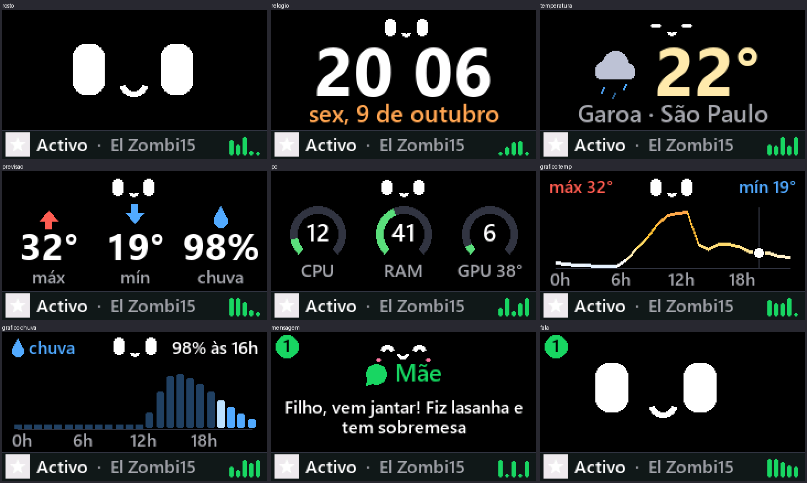

# M5 Desk Helper

Um bichinho de mesa para o **M5StickC Plus**: um rostinho que reage a você e alterna entre relógio, clima, previsão, uso do PC e a música que está tocando.



## O que faz

- **Rosto animado** com expressões, piscadas e reações ao movimento (acelerômetro) e ao som.
- **Relógio, temperatura, previsão e gráficos** de temperatura e chuva do dia (via Wi-Fi).
- **Painel do PC**: CPU, RAM e GPU em tempo real pelo cabo USB.
- **Música**: faixa, artista e capa do Spotify ou de qualquer player do Windows.
- **Mensagens e rotina**: avisos na tela e lembretes ao longo do dia.

## Controles

| Botão | Clique | Dois cliques | Segurar |
|---|---|---|---|
| A (frente) | próxima tela | carinho | menu de telas |
| B (lateral) | brilho | liga/desliga o som | ajuste fino do brilho |

Ligue segurando o **B** para configurar o Wi-Fi de novo.

## Como usar

**Firmware** (PlatformIO):

```bash
pio run -t upload
```

**Companion do PC** (Python 3):

```bash
pip install -r pc/requirements.txt
pythonw pc/companion.py
```

Crie `pc/lastfm.json` (`{"user": "...", "api_key": "..."}`) se quiser usar o Last.fm.

## Licença

[MIT](LICENSE)
